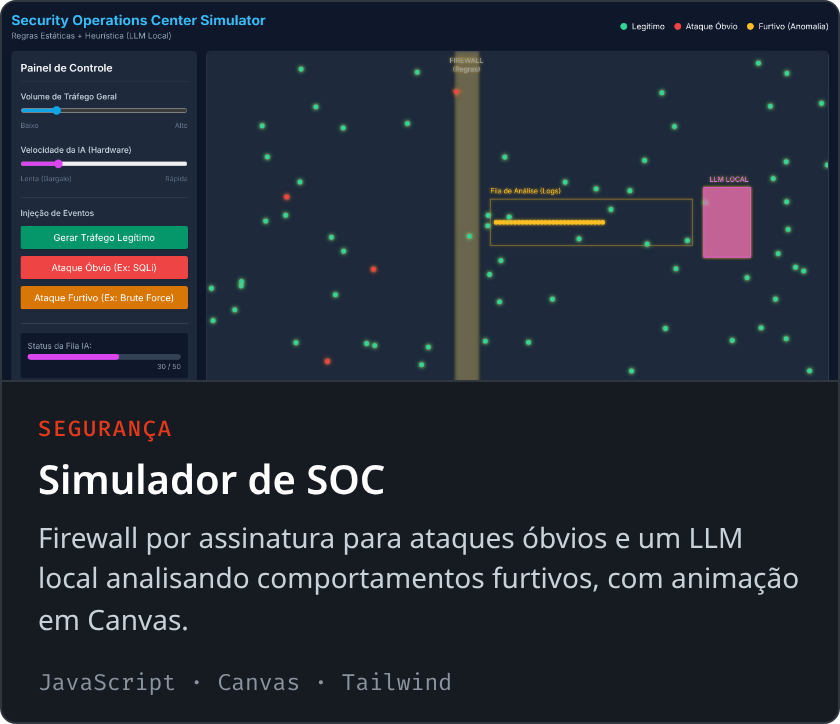

  

  

  
  
  
  
  

---

## 👨‍💻 Sobre mim

Sou **Software Engineer Full Stack** e gosto de levar aplicações **do zero à produção**: arquitetura, API, banco de dados, interface, testes e deploy. Hoje construo sistemas reais para negócios locais, como lojas, delivery e sites com painel administrativo próprio, que os donos gerenciam sem mexer em código.

- 📍 Videira, SC, Brasil
- 🎓 Ciência da Computação na **UNOESC**
- 🛠️ No dia a dia: **TypeScript, React, Node.js, PHP/Laravel, Python e C#**
- 🤖 Interesses: arquitetura de sistemas, automação com IA, segurança da informação, Desenvolvimento web e desenvolvimento de software
- 🌐 Portfólio: **[devborges.vercel.app](https://devborges.vercel.app/)**

## 🧰 Tecnologias

  
   
  

## 🚀 Projetos em destaque

  
  

  
  

  
  

  

## 📊 Estatísticas

  
  

---

  💬 Aberto a oportunidades e parcerias. Me chama no <a href="https://www.linkedin.com/in/devborges-joaovitor/" target="_blank" rel="noopener noreferrer">LinkedIn</a>! 
  ⭐ Se algum projeto te ajudou ou te interessou, deixa uma estrela!

  

